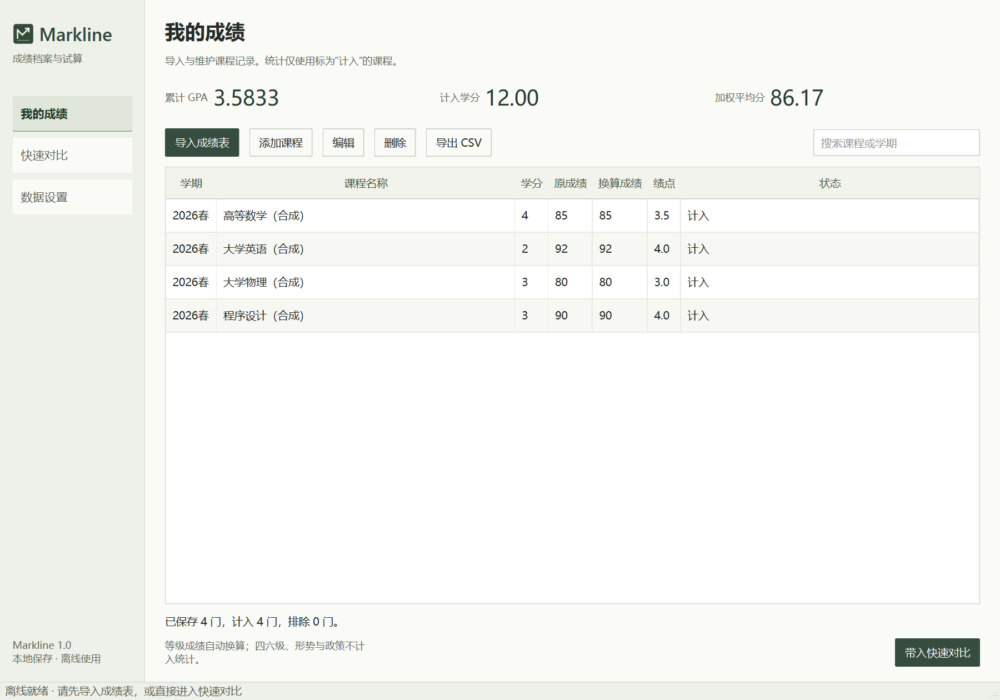
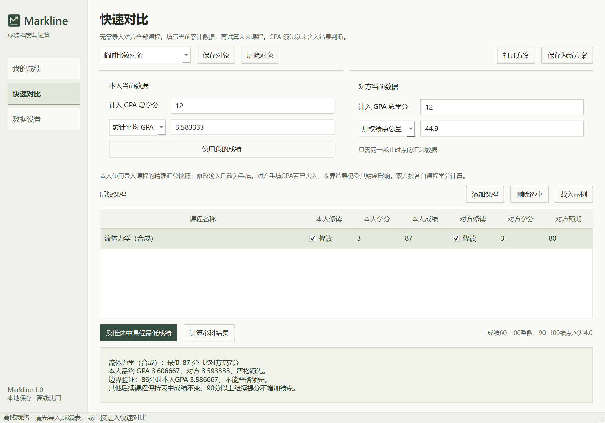

# Markline

Windows 离线成绩档案与 GPA 试算工具。Python + PySide6 + SQLite。

[下载 Windows 单文件 EXE](https://github.com/alyahromagnoli-create/Markline/releases/latest) · [使用说明](docs/UserGuide.zh-CN.md)

## 功能

- **我的成绩**：导入 XLS / XLSX / CSV，识别课程、学期、学分和成绩；支持本地维护、重复记录更新和 CSV 导出。
- **快速对比**：输入双方当前计入 GPA 的学分、累计平均 GPA 或加权绩点总量，保存多个比较对象。
- **单科反推**：计算指定后续课程严格反超所需的最低整数成绩，并验证低一分时的边界。
- **多科试算**：调整未来课程成绩，查看累计 GPA、提分收益与最高可行性。
- **方案与数据**：保存独立方案快照，备份与恢复本地数据库。





截图和内置示例均为合成数据。

## 离线与隐私

软件无需账号，不调用 AI API，不连接服务器或云数据库，也没有成绩上传和遥测功能。

成绩、比较对象、方案和上次试算保存在 **EXE 旁的 `data/Markline.db`**。备份也是本地文件。移动程序时请同时移动 `data` 文件夹。本仓库和发行附件不含个人成绩表、数据库、备份或真实学生身份信息。

## 下载运行

1. 在 [Releases](https://github.com/alyahromagnoli-create/Markline/releases/latest) 下载 `Markline.exe`。
2. 放在可写的 D 盘目录后双击，无需安装 Python。
3. 导入自己的成绩表，或直接进入快速对比填写汇总数据。

**当前 v1.0.0 构建要求有可写的 D 盘**：单文件运行时解包目录固定为 `D:\workspace\MarklineRuntime`；个人数据仍在 EXE 旁的 `data` 中。这是当前构建限制，并非所有 Windows 电脑都适用。面向 Windows 10/11 x64；实际验收环境为 Windows 11 x64，未在第二台实体电脑验证。

## 计算规则

| 百分制/等级 | 换算 |
|---|---|
| 60–89 整数 | `(成绩 - 50) / 10` |
| 90–100 整数 | 4.0 |
| 优 / 良 / 中等 | 95 / 85 / 75 分 |
| 合格 / 及格 | 65 分 |

四六级、形势与政策和零学分课程不计入 GPA 或百分制加权平均分。其他不支持或缺失成绩会列为待处理。所有有效课程按学分加权，双方分别使用各自的学分分母。

**严格高于才算反超，并列不算。** 内部使用精确有理数比较，显示舍入不参与判定。90–100 为绩点平台，不能通过提高到 100 分获得超过 4.0 的单科绩点。

手填累计 GPA 如果已被学校舍入或截断，结果仅基于输入精度。课程集合不同的数值比较不代表同课程水平或官方排名。软件不自动处理学校重修替代政策，不支持 60 分以下成绩，也不预测考试结果。

## 从源码运行

在 Windows PowerShell 中，进入位于 D 盘的项目目录：

```powershell
$env:TEMP = "$PWD\work\tmp"
$env:TMP = $env:TEMP
$env:PIP_CACHE_DIR = "$PWD\work\pip-cache"
New-Item -ItemType Directory -Path $env:TEMP -Force | Out-Null
python -m venv .venv
.\.venv\Scripts\python.exe -m pip install -r requirements.txt
.\.venv\Scripts\python.exe src\main.py
```

也可通过 `--data-dir` 指定本地数据目录。

## 测试与构建

```powershell
.\.venv\Scripts\python.exe -m pytest tests -q
.\build.ps1
```

构建输出为 `outputs/Markline.exe`。构建脚本限制当前进程 PATH，避免错误收集其他工具的同名 ICU 库，不会修改系统 PATH。构建缓存和临时文件位于项目 `work` 文件夹。

v1.0.0 通过 27 项测试；单 EXE 复制到独立中文空格目录、清空 Python/Qt 环境并限制 PATH 后完成启动、XLS/XLSX/CSV 导入、反推、方案保存、备份及排除课程验证。这是本机隔离验证，不等同于第二台电脑测试。

## 许可

Markline 原创代码使用 [MIT License](LICENSE)。PySide6/Qt、Python、xlrd、openpyxl 等组件保留各自许可证，完整声明和适用文本位于 [resources/licenses](resources/licenses)。单文件 EXE 内也附带这些文本、源码和构建脚本，可在数据设置中打开第三方许可目录。
